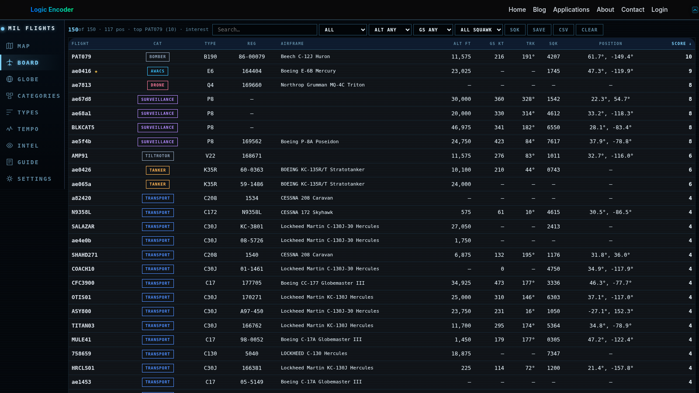

# Military Flights Monitor

Publicly visible aircraft activity can be difficult to explore in a long list of positions and aircraft identifiers. Military Flights Monitor brings the available military-aircraft observations into a map, globe and searchable board, making it easier to explore the activity that is actually being broadcast.

## Tech stack

| Layer | Technologies |
|---|---|
| Core stack | Python; PHP; WordPress; JavaScript |

## Explore the map and globe

The geographic views place observations in their spatial context. Navigation, fitting and measurement controls help move from an overall picture to an area of interest. A globe provides another way to explore the same publicly visible activity.

Start with the area of interest, then move closer when an observation deserves attention. The map and globe offer complementary ways to explore the spatial relationships in the available broadcasts.

## Find a relevant observation

The board supports filtering, sorting and paging through aircraft records. Categories and aircraft-type views help narrow a busy feed to the class of activity being examined. Callsigns and available identifying details give the user a starting point for closer inspection.

The board is useful when the investigation begins with an aircraft detail rather than a location. Filters and sorting narrow the observations before a record is examined more closely.

## Compare patterns

Dedicated category, type, squawk and tempo views offer different ways to explore the current observations. They help turn a long feed into questions that can be investigated. An interpretation should remain tied to the information actually available.

Each specialist view provides a different way to organise the same available activity. Compare the relevant category or period before drawing a conclusion about a pattern.

## Keep useful work

Saved selections and export controls support retaining the observations relevant to an investigation. Guide and display settings help make the workspace easier to navigate during repeated visits. Site administration provides the corresponding health and publishing controls.

Saved work and exports make it easier to return to a specific selection. They support a repeatable review rather than relying on a transient view of the map.

## Understand the coverage

The product uses publicly available ADS-B observations from adsb.fi. Only aircraft present in that source can appear; many aircraft and operations are not represented. The board is a view of available broadcasts, not a complete account of military aviation.

The source's coverage sets the boundary of the picture. Use the board to explore the observations it contains while retaining that boundary when sharing or interpreting a result.

---

Private code: [mil-flights-bridge](https://github.com/logicencoder/mil-flights-bridge)

See [REPOS.md](REPOS.md) for related repositories.

**[Logic Encoder](https://logicencoder.com)** · [GitHub](https://github.com/logicencoder) · [Contact](https://logicencoder.com/contact/)
