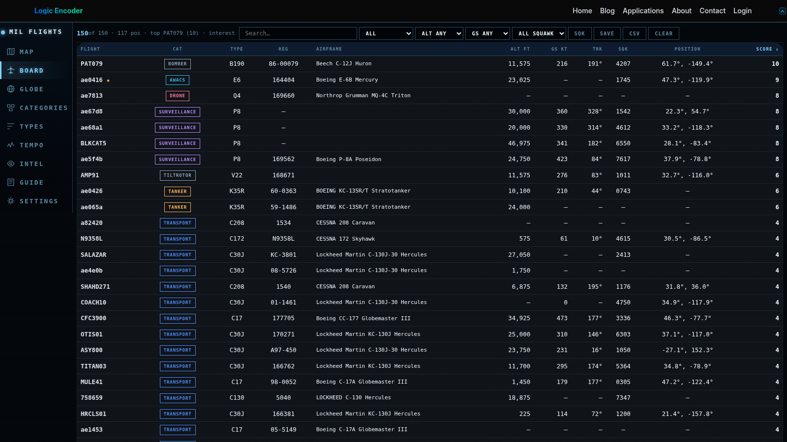

# Military Flights Monitor

Publicly visible aircraft activity can be difficult to explore in a long list of positions and aircraft identifiers. Military Flights Monitor brings the available military-aircraft observations into a map, globe and searchable board, making it easier to explore the activity that is actually being broadcast.

## Tech stack

| Layer | Technologies |
|---|---|
| Core stack | Python; PHP; WordPress; JavaScript |

## Explore the map and globe

The **Map** is the primary radar view: click an aircraft for details, switch on measuring to read distances between points, and see an activity-density layer built from the sighting history. The **Globe** shows the same live data in 3D and can be rotated by dragging.

Start with the area of interest, then move closer when an observation deserves attention. The map and globe offer complementary ways to explore the spatial relationships in the available broadcasts.

## Find a relevant observation

The **Board** lists every tracked military aircraft and sorts it, with callsign, airframe description and an interest score. Emergency squawks (7500, 7600 and 7700) and VIP airframes are flagged, and aircraft without a position are marked as dark.

The board is useful when the investigation begins with an aircraft detail rather than a location. Filters and sorting narrow the observations before a record is examined more closely.

## Compare patterns

**Categories** shows the mix of transports, tankers, airborne early warning and surveillance aircraft; **Types** ranks airframe types by interest score; **Tempo** counts aircraft detected per hour over the last 48 hours, including the high-interest ones, from the site's own history; **Intel** lists aircraft holding a tight patrol box (orbit watch), airframes first seen in the last day and the most-tracked fleet in the log window.

Each specialist view provides a different way to organise the same available activity. Compare the relevant category or period before drawing a conclusion about a pattern.

## Keep useful work

The **Guide** explains category, score, squawk and the fields. **Settings** adjust the accent colour, font, density and rows per page, and the choices are remembered in the browser. Site administration provides the health and publishing controls.

Remembered display settings make a repeated review start the same way each time, and the Guide keeps the meaning of each field one click away.

## Understand the coverage

The product uses publicly available ADS-B observations from adsb.fi. Only aircraft present in that source can appear; many aircraft and operations are not represented. The board is a view of available broadcasts, not a complete account of military aviation.

The source's coverage sets the boundary of the picture. Use the board to explore the observations it contains while retaining that boundary when sharing or interpreting a result.

---

Private code: [mil-flights-bridge](https://github.com/logicencoder/mil-flights-bridge)

See [REPOS.md](REPOS.md) for related repositories.

**[Logic Encoder](https://logicencoder.com)** · [GitHub](https://github.com/logicencoder) · [Contact](https://logicencoder.com/contact/)

<!-- TODO(screenshots, 2026-11-07): new screenshot -->
